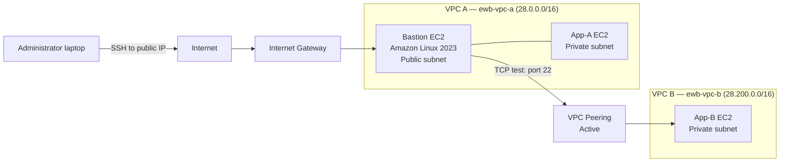

# AWS VPC Peering Mini-Project

A hands-on AWS networking lab demonstrating VPC peering between two VPCs, route-table configuration, security-group rules, and connectivity testing through a public bastion host.

> **Lab note:** This repository documents the environment that was tested. The lab used `28.0.0.0/16` and `28.200.0.0/16` as its VPC CIDRs. These are **not RFC 1918 private IPv4 ranges**. For a new deployment, use non-overlapping private CIDRs such as `10.10.0.0/16` and `10.20.0.0/16`, unless your instructor explicitly requires the original values.

## Objectives

- Create two VPCs and subnets.
- Configure a public bastion host in VPC A.
- Establish VPC peering between VPC A and VPC B.
- Add routes to both VPC route tables.
- Configure security groups for SSH access.
- Test TCP connectivity from the bastion to private instances.
- Document results and limitations.

## Architecture



The diagram is conceptual. Use the AWS Console screenshots from your own account as evidence of the deployed resources.

## Environment and resources

| Resource | Lab name / value |
|---|---|
| AWS Region | Asia Pacific (Sydney), `ap-southeast-2` |
| VPC A | `ewb-vpc-a` |
| VPC A CIDR | `28.0.0.0/16` |
| VPC B | `ewb-vpc-b` |
| VPC B CIDR | `28.200.0.0/16` |
| Subnets | `ewb-a-public`, `ewb-a-private`, `ewb-b-private` |
| Internet gateway | `ewb-igw-a` |
| Route tables | `ewb-rt-a-public`, `ewb-rt-a-private`, `ewb-rt-b-private` |
| VPC peering | `ewb-a-b-peer` |
| Security groups | `ewb-sg-bastion`, `ewb-sg-app-a`, `ewb-sg-app-b` |
| Bastion OS | Amazon Linux 2023 |
| Bastion access | SSH from the administrator laptop |

## Route-table design

- **VPC A public route table:** local route for VPC A, default route to the Internet Gateway, and route to VPC B through the peering connection.
- **VPC A private route table:** local route for VPC A and route to VPC B through the peering connection.
- **VPC B private route table:** local route for VPC B and route to VPC A through the peering connection.

Routes must point to the active VPC peering connection, and the relevant subnet must be associated with the intended route table.

## Validation results

The following results were observed during the lab:

| Test | Result | Interpretation |
|---|---|---|
| SSH from laptop to bastion | Successful | Bastion was reachable using SSH |
| VPC peering status | Active | Peering connection was established |
| TCP from bastion to App-A on port 22 | Successful (`exit code 0`) | TCP connection to SSH port succeeded |
| TCP from bastion to App-B on port 22 | Successful (`exit code 0`) | TCP connection to SSH port succeeded |
| ICMP ping from bastion to App-B | Failed; 100% packet loss | ICMP was not confirmed; check ICMP rules and host/network settings |

**Important:** A successful TCP connection to port 22 does not prove an interactive SSH login will succeed. Authentication, usernames, key permissions, and SSH daemon configuration must also be correct. A failed ping alone does not prove that VPC peering is broken.

## Test commands

Run these commands **inside the bastion SSH session**. Replace the example private IPs with the current private IPs shown in your EC2 console.

```bash
# Test TCP reachability to App-A SSH
timeout 5 bash -c 'cat < /dev/null > /dev/tcp/28.0.2.184/22'
echo $?

# Test TCP reachability to App-B SSH
timeout 5 bash -c 'cat < /dev/null > /dev/tcp/28.200.1.177/22'
echo $?

# Optional ICMP test (may fail if ICMP is not allowed)
ping -c 4 28.200.1.177
```

For the TCP tests, exit code `0` indicates the TCP connection succeeded. A non-zero result means the connection failed or timed out.

## Security guidance

- Never upload `.pem` private keys, passwords, AWS access keys, account IDs, or unredacted credentials.
- Do not commit `.env` files or private connection files.
- Restrict SSH ingress to your own trusted public IP where practical.
- For private instances, prefer access through a bastion or AWS Systems Manager where configured.
- Avoid exposing SSH or remote desktop ports to `0.0.0.0/0`.
- Use non-overlapping RFC 1918 private CIDRs for new VPC designs.

## Repository contents

- `docs/PROJECT_REPORT.md` — report suitable for editing and exporting to PDF.
- `diagrams/architecture.mmd` — Mermaid architecture diagram source.
- `scripts/connectivity-tests.sh` — reusable TCP connectivity test script.
- `screenshots/README.md` — checklist for adding evidence screenshots.
- `.gitignore` — excludes common credentials and generated files.

## Evidence screenshots to add

Save redacted screenshots in `screenshots/`:

1. VPC A and VPC B details.
2. VPC peering connection showing **Active**.
3. VPC A public route table.
4. VPC A private route table.
5. VPC B private route table.
6. EC2 instances and their state.
7. SSH session connected to the bastion (hide sensitive details).
8. TCP test results from the bastion.
9. ICMP ping result, labelled accurately as a failed test.

## Author

Add your name, course, institution, and project date here before submission.
